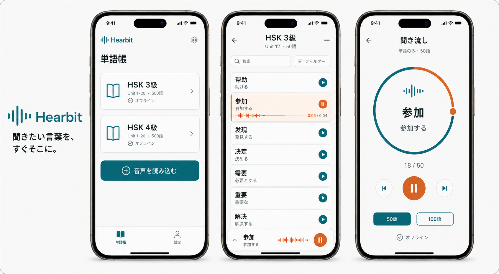
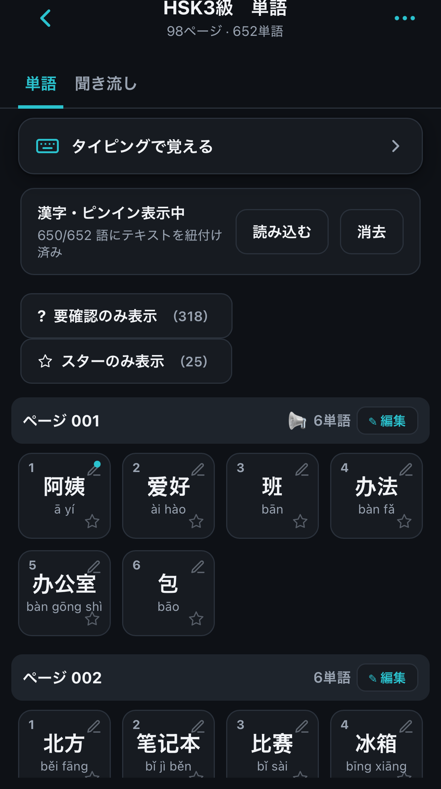
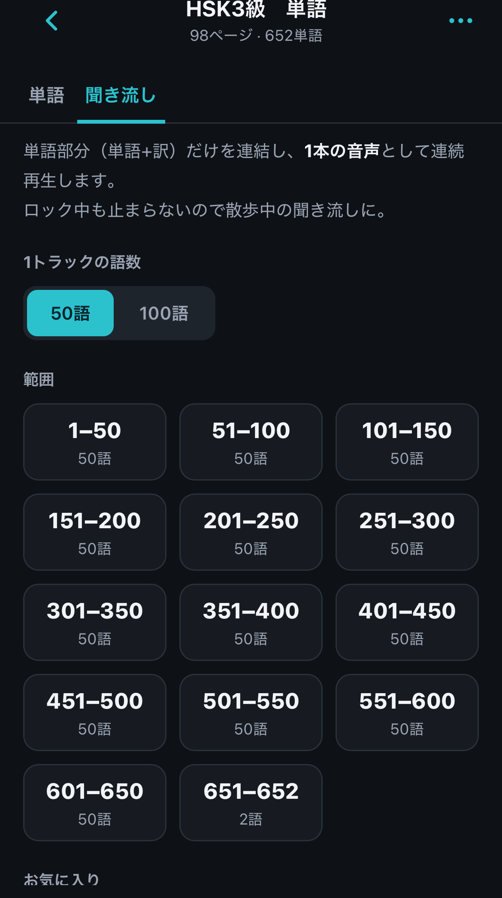
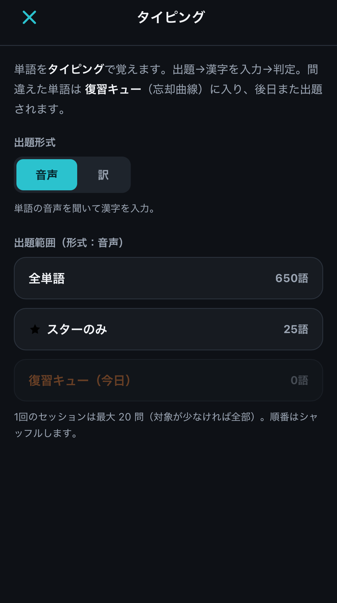
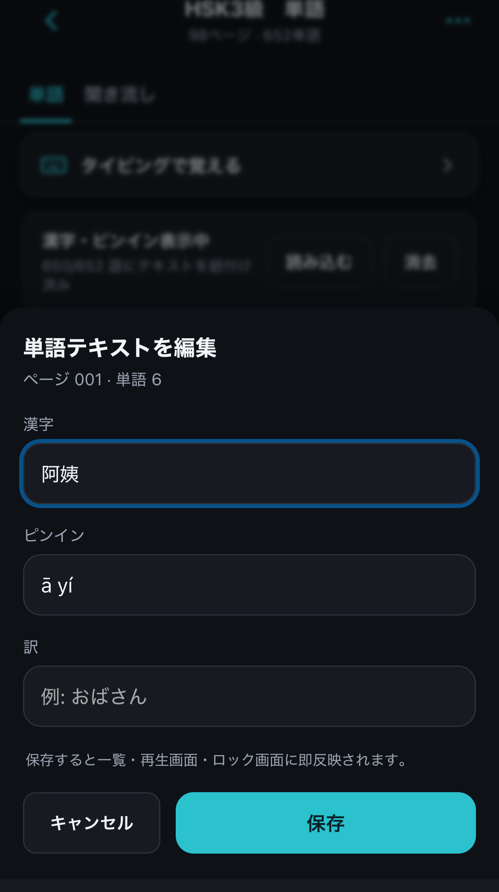

# Hearbit（ヒアビット）

**聞きたい言葉を、すぐそこに。**

手元の単語帳音声を持ち込み、ブラウザ内で単語単位に分割して再生できる、汎用の単語帳プレーヤー（PWA）。



> 完全個人利用・非商用のツールです。音声は端末内（IndexedDB）に保存され、サーバには一切アップロードされません。元音声は著作物のためリポジトリには含めません。

---

## なぜ作ったか

語学学習で単語帳の音声教材（例: HSK中国語単語帳）を使っていましたが、既存の単語帳アプリでは次のような不便がありました。

- **自分が持っている単語帳音声を持ち込めない**：既存アプリは内蔵コンテンツしか再生できず、手元にある教材の音声ファイルをそのまま活かせない
- **聞きたい単語にすぐ戻れない**：音声ファイルがページ単位（1ファイルに数語〜十数語が連続収録）で長く、特定の単語を聞き直したいときに毎回シークが必要で煩わしい

これらを解決するために、**「自分の音声ファイルを読み込ませて、単語単位で自由に再生できるプレーヤー」** を自作することにしました。単語ごとに音を切り出しておけば、聞きたい単語にワンタップで戻れる／散歩中に単語だけを連続で聞き流せる、という体験が実現できます。

## コンセプト

**音声を同梱するアプリではなく、音声を持ち込んで使う汎用プレーヤー。**

- ユーザーが自分の単語帳音声フォルダをアプリに読み込む → ブラウザ内で無音区間を検知して単語ごとに分割 → 端末内（IndexedDB）に保存
- 音声はサーバに一切アップロードしない（著作権クリア・非商用の前提を守る）
- 複数の単語帳を登録・切り替えて使える（例: HSK3級・HSK4級 など）
- アプリのコード自体はクラウド（Vercel等）に無料でデプロイ可能（音声本体はデプロイ対象外）

## できること（機能）

| 機能 | 内容 |
|---|---|
| **機能A: タップ再生** | 単語をタップすると、その単語（単語→訳→例文2つ）だけを再生。聞きたい単語にすぐ戻れる |
| **機能B: 聞き流し** | 単語部分（単語+訳、例文は除く）だけを50語／100語単位で1本に連結し連続再生。ホーム画面に戻っても・ロック中も止まらないので散歩中の聞き流しに。▼で閉じるとミニプレーヤーになり、再生したまま他の画面を操作できる |
| **機能C: PWA本体** | 単語帳の読み込み・分割・管理・再生UI。ホーム画面に追加してアプリのように使える |
| **単語テキストの編集** | 音声から自動認識した漢字・ピンイン・訳を、単語ごとに手動で修正可能。保存すると一覧・再生画面・ロック画面に即反映 |
| **要確認フラグ** | 取り込んだ音声の認識に不安がある単語をシステム側が自動検出し「要確認」としてマーク。該当単語のみ絞り込み表示できる |
| **スター（お気に入り）** | 単語にスターを付けて、一覧・聞き流し・タイピングをスターのみに絞り込める |
| **タイピング学習** | 単語を見て／音声を聞いて漢字を入力する形式で暗記。間違えた単語は復習キュー（忘却曲線に基づくSRS）に入り、後日再出題される |

### 画面構成（3階層）

```
① 単語帳を選ぶ（複数の単語帳が並ぶ／新規追加）
    ↓
② ページ / 単語一覧（番号表示。単語 / 聞き流し タブ。要確認・スターで絞り込み）
    ↓
③ 再生・学習
    機能A: タップ再生 ／ 機能B: まとめ聞き流し ／ タイピング学習
```

### 実際の画面

<table>
<tr>
<td></td>
<td></td>
<td></td>
<td></td>
</tr>
<tr>
<td align="center">単語一覧（要確認・スター絞り込み）</td>
<td align="center">聞き流し（50語/100語単位）</td>
<td align="center">タイピング学習（SRS復習）</td>
<td align="center">単語テキストの編集</td>
</tr>
</table>

## 使い方（概要）

1. 手元の単語帳音声（mp3ファイル群）を用意する
2. Hearbitを開き「⊕ 音声を読み込む」から音声ファイルをまとめて選択
3. ブラウザ内で自動的に無音区間を検知し、単語ごとに分割される
4. 単語をタップして再生（機能A）／「聞き流し」タブで50語・100語単位を連続再生（機能B）
5. 一度読み込めば、以降は端末内データのみで動作（オフライン・電波不要）

## フォルダ構成

```
vocab-audio-separator/
├── app/                    PWA本体（Hearbit）
│   ├── index.html          3画面UI + PWAメタ + Service Worker登録
│   ├── manifest.json       PWAマニフェスト
│   ├── sw.js                Service Worker（App Shellキャッシュ・オフライン起動・版番号）
│   ├── icons/               アプリアイコン
│   ├── css/styles.css       デザインシステム（ティール×オレンジ）
│   ├── js/
│   │   ├── db.js             IndexedDB: 単語帳メタ + 元音声Blob
│   │   ├── splitter.js       Web Audio API による無音検知・分割ロジック
│   │   ├── editor.js         分割結果の手動編集ロジック
│   │   ├── player.js         機能Aの再生エンジン（区間再生・前/次・Media Session）
│   │   ├── listen-build.js   機能Bの「単語+訳」抽出・チャンク分割・WAV変換（純関数）
│   │   ├── listen.js         機能Bの再生（連結1本を <audio> で再生・ミニプレーヤー連携）
│   │   ├── typing.js / srs.js タイピング学習・忘却曲線復習
│   │   ├── version.js        アプリのバージョン（設定に表示・更新バナーの判定）
│   │   └── app.js            画面遷移・単語一覧・プレーヤー連携
│   └── verify/               自動テスト（分割の Python 一致・再生ロジック・実Chrome UI・更新導線）
├── audio/
│   ├── raw/                 元のページ音声（001.mp3 …）※手動配置・git管理外
│   ├── words/                分割後の単語ごと音声 ※自動生成・git管理外
│   └── chunks/                50語/100語のまとめ音声 ※自動生成・git管理外
├── data/                    分割メタデータ・ブランド定義・モックアップ画像など
├── src/                     分割ロジック検証用のPython版スクリプト
└── README.md
```

音声ファイルは `.gitignore` で除外している。元音声は各自の手元（例: `~/Downloads/HSK3級単語/`）に保管する。

## 処理ロジック（音声分割の仕組み）

各ページ音声（1ファイルに複数単語を収録、約60〜95秒）は、次のような構造になっている。

```
[冒頭アナウンス（任意）]  ← 「動詞」等の品詞見出しやセクション見出し
[単語1] [単語2] ...       ← 1単語 = 単語(中国語) → 日本語訳 → 例文1 → 例文2
```

### 無音検知による分割

音声内の無音区間の長さを解析すると、明確に2種類に分かれることが分かった。

| 無音の種類 | 長さの目安 | 意味 |
|---|---|---|
| 単語境界 | 約2.0〜2.2秒以上 | 単語と単語の区切り（分割点） |
| ブロック境界 | 約0.5〜1.7秒 | 単語内の「単語→訳→例文」の区切り |

→ **閾値2.0秒**で単語境界とブロック境界をきれいに分離できる。この境界をもとに、ページ音声を単語ごとのセグメントに機械的に分割する。

### 容量最適化：位置指定方式

分割後の音声を別ファイルとして保存すると容量が膨らむため、実際に保存するのは **【元音声 + 分割位置のJSON（数KB）】** のみ。再生時に「元音声の◯秒〜◯秒」を位置指定で鳴らすことで、分割済み音声を別途保存せずに単語単位の再生を実現している（HSK3級で元音声139MB程度）。

### アナウンスの扱い

音声だけからアナウンス（冒頭の品詞・見出し）を機械的に判定するのは単語帳ごとに精度がばらつくため、以下の方式を採用。

- 分割自体は無音境界のみで機械的に行う（確実）
- 各セグメントに `type`（単語のみ / 単語+アナウンス）のラベルを付与
- 正解データ（ユーザーが目視確認したもの）で判定を確定、他の単語帳では超過分のヒューリスティックで自動判定
- アナウンスと単語本体の境界は、先頭セグメント内の無音から選ぶ（ページ冒頭の無音余白は候補から除外）
- 他の単語帳でも確実に扱えるよう、発話ブロックに役割（アナウンス/単語/訳/例文）を持たせ、推定＋ユーザー確認で確定する方式を設計中（Issue #20）

### 検証方法

Python版で分割ロジックを検証・確定させたのち、同じロジックをJS（Web Audio API）に移植。両者の分割結果（セグメント数・カット位置）が一致することをテストで確認している（現状 全98ページで98/98一致）。

## 技術スタック

- **フロントエンド**: 素のHTML/CSS/JS（フレームワークなし・ビルド不要・依存最小）＋ PWA
- **音声処理**: Web Audio API（decode・無音検知・分割）
- **再生**: `<audio>` 要素（機能Aは元音声の区間再生、機能Bは連結1本を WAV にして再生）。iOS でもバックグラウンド・ロック中に止まらず、消音スイッチの影響を受けない
- **保存先**: IndexedDB（元音声Blob + 分割位置メタデータ）
- **バックグラウンド再生**: Media Session API（ロック画面・イヤホン操作対応）
- **更新**: ホーム画面の PWA でも新しい版が届いたら「更新があります」バナー（タップで再読み込み）。設定画面に版を表示
- **検証用（Python版）**: `ffmpeg` / `ffprobe` による無音解析。分割ロジックの正しさの証明・正解データ作成に使用

### 必要環境（Python版を動かす場合）

- `ffmpeg` / `ffprobe`（`brew install ffmpeg`）
- Python 3

## 開発体制

各機能は 設計 → 実装 → レビュー → 検証 → マージ の順で進行。サブエージェント（音声処理担当・PWA実装担当・UI設計担当・コードレビュー担当・検証担当）が役割分担して開発している。詳細は `CLAUDE.md` を参照。

## 進捗

- [x] 音声解析・分割ロジック確定（Python版で検証）
- [x] 分割ロジックのJS移植（Web Audio API、Python版とカット点98/98一致）
- [x] **機能C**: PWA本体（単語帳の登録・切替・削除、単語一覧UI、タップ再生、PWA化、Media Session）— iPhone実機動作確認済み
- [x] **機能B**: 聞き流し（単語+訳を50語/100語単位で連結した1本を生成・アプリに統合・バックグラウンド再生・ミニプレーヤー・通し番号表示）
- [x] 単語テキスト（漢字・ピンイン・訳）の紐付け・手動編集
- [x] 要確認フラグ・スター（お気に入り）機能
- [x] タイピング学習・忘却曲線に基づく復習（SRS）
- [x] 分割の手動編集（境界の追加・削除・微調整）
- [x] PWA の更新導線（バージョン表示・更新バナー）
- [ ] 音声の追加読み込み（Issue #5）
- [ ] アナウンス判定の汎用化：発話ブロックの役割モデル＋ユーザー確認（Issue #20）
